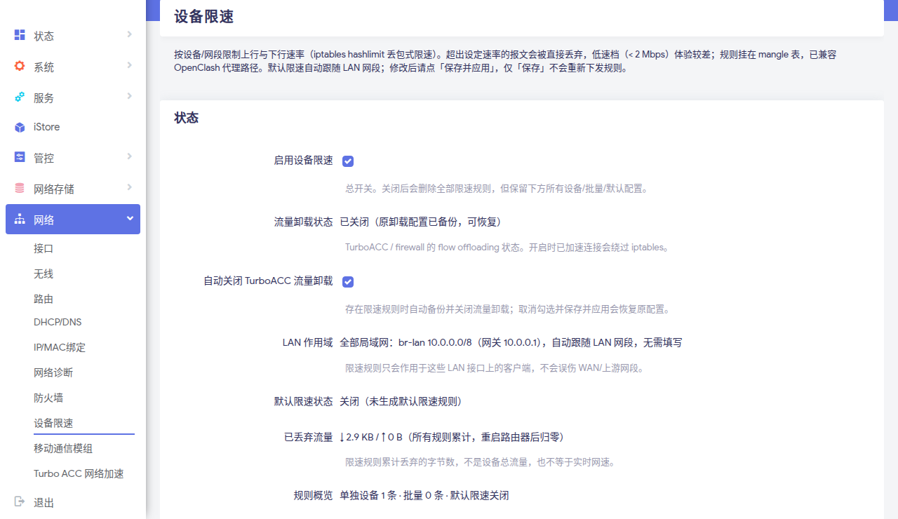
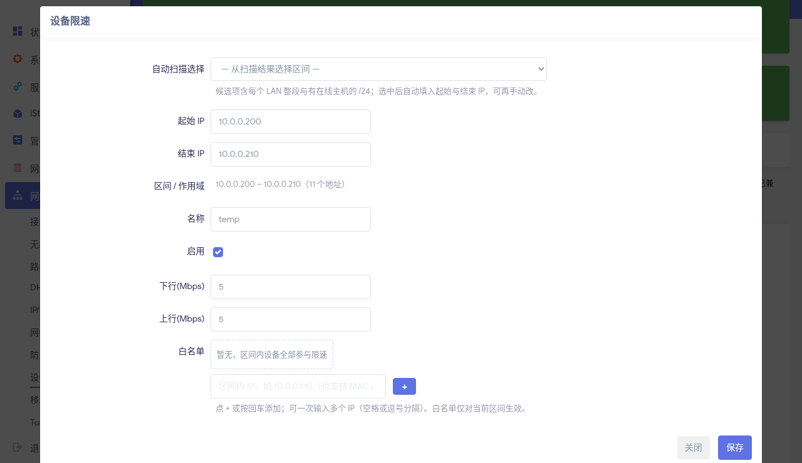

# luci-app-hlimit

[](LICENSE)


> OpenWrt / LuCI 按设备、按 IP 区间、按全局默认的限速插件。
> 纯 `iptables -m hashlimit` 实现，不需要 `tc` / `nft` / `htb` / `ifb`。

## 它解决什么问题

有些路由器固件（例如 Cudy TR3000 v1 的 LEDE 24.10）内核裁剪掉了 `tc`、`nftables`、
`htb/tbf/cake`、`ifb`，无法用常规流量整形（shaping）限速。这台机器上唯一可用的
限速原语是 iptables 的 `hashlimit` 模块 —— 也就是**超速丢包（policing）**。

`luci-app-hlimit` 把 `hashlimit` 封装成一个完整的 LuCI 应用：图形界面配置、
按设备 / 按 IP 区间 / 全局默认三级规则、优先级与白名单、开机与防火墙重载后自动恢复。

| | tc 整形（部分固件没有） | 本插件（hashlimit 丢包） |
|---|---|---|
| 机制 | 排队、削峰 | 超过速率的报文直接丢弃，TCP 自行重传降速 |
| Bufferbloat | 可以治理 | 不治理 |
| ≥ 5 Mbps | 平滑 | 可用 |
| < 2 Mbps | 平滑 | **体验明显变差** |

**如实说明：这不是 SQM。** 低速档（尤其 < 2 Mbps）会有明显丢包与卡顿，
对延迟敏感的设备请给足带宽或错峰使用。

## 功能

- **单设备限速**：按 IP 或 MAC 匹配，上下行独立设置，单台独立启停；
  `0` 表示该方向不限速（`0/0` 即"该设备豁免"）。
- **批量限速**：直接填 **起始 IP** 和 **结束 IP**（例如 `10.0.1.1` – `10.0.2.1`），
  不需要心算 CIDR / 掩码；区间跨子网时自动按 LAN 子网拆分下发。
- **默认限速**：一条规则覆盖全部 LAN 接口的所有客户端，无需填写网段。
- **每组白名单**：同一批量规则内可以给指定 IP / MAC / 子区间放行，仅对当前规则生效。
- **自动扫描**：从 LAN 网段、DHCP 池、在线主机中生成候选区间，选中即回填起止 IP。
- **LAN 自动作用域**：运行时从 fw3 `lan` 区域推导 LAN 网段，`10.x` / `192.168.x`
  等任意私有网段开箱即用；规则带 `-i/-o <LAN 网口>` 限定，不会误伤同网段的 WAN 上游。
- **OpenClash 友好**：规则挂在 `mangle` 表 `PREROUTING`（上行）/ `POSTROUTING`（下行），
  经过 REDIRECT / TPROXY 的代理流量同样被限速。
- **自动关闭流量卸载**：检测到有限速规则时自动备份并关闭 TurboACC / `FLOWOFFLOAD`，
  停用或卸载时还原（被硬件卸载的连接会绕过 iptables）。
- **持久化**：`/etc/firewall.user` 受管钩子 + 开机脚本 + DHCP 热插拔，重启、防火墙重载后自动重建规则。
- 纯 LuCI 客户端侧 JS 界面（中文），无外部前端库依赖。

## 截图





## 兼容性

| 项目 | 要求 |
|---|---|
| 固件 | OpenWrt 24.10 / LEDE 24.10，**fw3 + iptables (legacy)** 防火墙 |
| LuCI | 客户端侧 JS 视图（`luci-base`），Argon / 原生主题均可 |
| 依赖包 | `luci-base` `rpcd` `rpcd-mod-file` `iptables` `iptables-mod-hashlimit` `iptables-mod-iprange` `firewall` |
| 内核模块 | `xt_hashlimit`、`xt_iprange`（随固件提供即可） |
| 网络 | LAN 为桥接（`br-lan` 或其它名称均可），IPv4 |

> **不支持 fw4 / nftables 固件**（OpenWrt 22.03+ 默认 nftables 的机型）。本插件依赖
> `iptables` 的 `mangle` 表与 `hashlimit`，在 nft 后端上不会生效。
> 参考验证环境：Cudy TR3000 v1，LEDE 24.10，Linux 6.6.75，iptables 1.8.7 (legacy)。

## 安装

### 方式一：ipk（推荐）

从 [Releases](../../releases) 下载 `luci-app-hlimit_<版本>_all.ipk`：

```sh
scp luci-app-hlimit_1.3.4_all.ipk root@192.168.1.1:/tmp/
ssh root@192.168.1.1
opkg install --force-reinstall /tmp/luci-app-hlimit_1.3.4_all.ipk
```

也可以在 LuCI「系统 → 软件包 → 上传安装」中直接上传 ipk。

安装脚本会自动：启停脚本加开机自启、写入 `/etc/firewall.user` 受管钩子（原有内容保留并备份）、
关闭流量卸载、迁移旧配置、下发规则并刷新 LuCI 缓存。完成后刷新页面，
左侧「网络 → 设备限速」即可看到入口。

升级时 `/etc/config/hashlimit-qos` 作为 conffile 保留，已有设备 / 批量 / 默认配置不会丢失。

### 方式二：源码构建（无需 OpenWrt SDK）

```sh
git clone https://github.com/shorekeeper-blackshore/luci-app-hlimit.git
cd luci-app-hlimit
./scripts/build-ipk.sh          # 产物：build/luci-app-hlimit_<版本>_all.ipk
```

`build-ipk.sh` 只依赖 `tar`、`gzip` 与 `sh`，会先做 shell 语法检查再打包，
同时输出一份源码 tar.gz 供 SDK 编译使用。可用环境变量 `OUT_DIR`、`HLIMIT_VERSION` 覆盖输出目录与版本号。

### 方式三：OpenWrt SDK / feeds

把本目录放进 `package/` 或 feeds 的 `luci/applications/` 下，再执行：

```sh
make package/luci-app-hlimit/compile V=s
```

`Makefile` 兼容 `feeds/luci/luci.mk`（目录约定 `root/`、`htdocs/`、`luasrc/`、`ucode/`；
本仓库把运行文件统一放在 `files/`，并用 `root -> files` 符号链接让 `luci.mk` 正常识别）。
非标准 SDK 布局可用 `LUCI_MK=/path/to/luci.mk` 指定。

## 使用

打开 **网络 → 设备限速**，页面分三块：

### 1. 状态

- **启用设备限速**：总开关。关闭会清空所有规则，但保留配置。
- **流量卸载状态**：显示 TurboACC / `FLOWOFFLOAD` 当前状态与备份情况。
- **自动关闭 TurboACC 流量卸载**：默认开启。
- **LAN 作用域**：只读，显示自动检测到的 LAN 接口与网段。
- **默认限速状态** / **已丢弃流量** / **规则概览**。

### 2. 设备限速

每台设备一行：名称、IP、MAC、下行 Mbps、上行 Mbps、启用、丢弃计数。

- 「添加设备」：填 IP（或留空只填 MAC）、名称、上下行速率（`0` = 该方向不限）；
  右侧「从在线设备选择」会列出 DHCP 租约 + ARP 表的在线主机，选中自动回填。
- 名称留空时自动使用当前主机名，再退化为 IP / MAC。
- 修改速率后点该行的「保存」，或统一点底部「保存并应用」。

### 3. 批量限速

每条规则匹配一个 IP 区间（起始 IP – 结束 IP），编辑弹窗内依次是：

1. **自动扫描选择**：从扫描结果挑一个候选区间，自动回填起止 IP；
2. **起始 IP** / **结束 IP**：任意同类 IPv4 区间，跨子网也可以；
3. **区间 / 作用域**：实时显示解析结果、地址数量与命中的 LAN 接口；
4. **名称**、**启用**、**下行 / 上行 Mbps**；
5. **白名单**：输入 IP / MAC / 子区间，点 **+** 或回车添加；胶囊点 **×** 删除。
   白名单变更即时生效（写 UCI 并重新下发规则），仅对该条批量规则有效。

### 4. 默认限速

一条覆盖全部 LAN 客户端的兜底规则，只需要两项速率（`0` = 不限）。
默认限速默认关闭，避免一装上就影响所有人。

修改完点右下角 **「保存并应用」**，仅点「保存」不会重新下发 iptables 规则。

### 优先级

```
单设备规则  >  批量规则白名单  >  批量规则  >  默认限速
```

高优先级命中即 `RETURN` / 生效，不再落入低优先级规则。单设备配置 `0/0` 就等价于
"这台设备不限速"（会盖过批量与默认规则）。

## 命令行

后端 `/usr/sbin/hlimit-ctl` 也可以脱离 LuCI 使用（所有 LuCI 操作最终都调用它）：

```sh
hlimit-ctl status                      # JSON：规则、计数、默认限速、卸载状态
hlimit-ctl devices                     # JSON：静态 + 租约 + ARP 在线主机
hlimit-ctl scan                        # JSON：LAN 子网 / DHCP 池 / 区间候选

hlimit-ctl global 0|1                  # 总开关
hlimit-ctl set <ip|-> <down_kbps> <up_kbps> [label] [enabled] [mac]
hlimit-ctl delete <ip|mac>
hlimit-ctl toggle <ip|mac> 0|1

hlimit-ctl group-set <start> <end> <down_kbps> <up_kbps> [label] [enabled]
hlimit-ctl group-delete <range|cidr>
hlimit-ctl group-toggle <range|cidr> 0|1
hlimit-ctl group-exclude-add <range|cidr> <ip|mac|range>
hlimit-ctl group-exclude-del <range|cidr> <ip|mac|range>

hlimit-ctl set-default 0|1 <down_kbps> <up_kbps>
hlimit-ctl render                      # 按当前配置重建 mangle 规则
hlimit-ctl flush                       # 删除链与跳转（保留配置）
hlimit-ctl apply                       # 提交 + migrate + 卸载处理 + render

hlimit-ctl offload-apply|offload-restore|offload-status
hlimit-ctl install-hook|remove-hook    # /etc/firewall.user 受管钩子
```

速率单位统一为 **kbit/s**（LuCI 界面用 Mbit/s，保存时换算）。
退出码：`0` 成功、`1` 用法错误、`2` 参数非法、`3` UCI / iptables 失败。

## 配置

配置位于 `/etc/config/hashlimit-qos`，section 类型：`defaults`（1 个）、`device`（多个）、`group`（多个）。

```uci
config defaults 'defaults'
	option enabled '1'
	option auto_disable_offload '1'
	option default_enabled '0'
	option default_down_kbps '0'
	option default_up_kbps '0'

config device 'dev_192_168_1_50'
	option ip '192.168.1.50'
	option mac 'aa:bb:cc:dd:ee:ff'
	option label '客厅电视'
	option enabled '1'
	option down_kbps '5120'
	option up_kbps '1024'

config group 'grp_10_0_1'
	option start '10.0.1.1'
	option end '10.0.2.1'
	option label '访客网段'
	option enabled '1'
	option down_kbps '10000'
	option up_kbps '2000'
	list exclude '10.0.1.10'
	list exclude 'aa:bb:cc:dd:ee:ff'
```

> 手工编辑后执行 `hlimit-ctl render`（或重启服务）使规则生效；运行中请优先用 LuCI 或 `hlimit-ctl`。
> `group` 的 `cidr` 是 1.2 / 1.3.0 的兼容字段，`hlimit-ctl migrate` 会自动转换成 `start`/`end`。

## 工作原理

```
mangle PREROUTING                                    mangle POSTROUTING
  └─ HLIMIT_UP (-i <LAN 网口>)                          └─ HLIMIT_DOWN (-o <LAN 网口>)
       ├─ 单设备：-s <ip> | -m mac --mac-source ...          ├─ 单设备：-d <ip> | -m mac --dst ...
       ├─ 批量：-m iprange --src-range a-b                   ├─ 批量：-m iprange --dst-range a-b
       │    └─ 白名单命中 → RETURN                           │    └─ 白名单命中 → RETURN
       └─ 默认：全部 LAN                                     └─ 默认：全部 LAN
            └─ -m hashlimit ... -j DROP                           └─ -m hashlimit ... -j DROP
```

- 上行在 `PREROUTING` 用 `-s`（源地址）、下行在 `POSTROUTING` 用 `-d`（目的地址）匹配；
- 每条规则额外用 `-i` / `-o <LAN 网口>` 限定，避免与同网段的 WAN 上游冲突；
- `hashlimit` 以"每源地址/目的地址 + 每秒字节数"为单位，超过 `--hashlimit-burst` 后 `DROP`；
- 规则在被测设备重新获取 IP / 重连后仍然有效（按地址匹配）；
- `/etc/firewall.user` 中的受管块会在每次 `fw3 reload` 后调用 `hlimit-ctl render` 重建规则。

## 已知限制

- **只做 policing（丢包），不做 shaping（整形）**：低速率下延迟、抖动与重传明显；
- 不处理 bufferbloat，也不提供 `cake/fq_codel` 式公平排队；
- 仅 IPv4；不区分协议/端口（需要的话请配合自定义 iptables 规则）；
- 同一 LAN 内部互访（同网段主机之间）不过 `PREROUTING/POSTROUTING`，不在限速范围内；
- 被硬件流量卸载的连接会绕过 iptables，插件默认自动关闭卸载；
- 修改配置后必须「保存并应用（render）」才会下发，仅保存 UCI 不生效。

## 常见问题

**装了但完全没效果？**
先确认点过「保存并应用」；再看「流量卸载状态」是否为关闭；用 `hlimit-ctl status` 检查规则数与计数是否增长。

**OpenClash 的流量被限速了吗？**
是。规则在 `mangle` 表，REDIRECT / TPROXY 之后仍会命中。

**换了 LAN 网段（例如 192.168.2.x → 10.0.0.x）？**
运行时自动检测，`hlimit-ctl migrate` 会把旧网段的配置适配到新 LAN。

**卸载 / 完全还原**

```sh
sh /usr/share/luci-app-hlimit/uninstall.sh   # 停服务、删规则、还原流量卸载、删配置与页面
# 或者只删包（配置作为 conffile 保留）
opkg remove luci-app-hlimit
```

## 开发

```sh
sh tests/unit/test-ctl.sh    # 后端单元测试（uci/iptables/logger 使用 stub，无需路由器）
node tests/ui/test-ui.js     # LuCI 界面离线自测（Node，无第三方依赖）
./scripts/build-ipk.sh       # 打包 ipk + 源码 tar.gz
```

目录结构：

```
.
├── Makefile                     # OpenWrt / luci.mk 打包入口
├── files/                       # 安装到路由器的运行文件
│   ├── etc/config/hashlimit-qos           # UCI 配置（conffile）
│   ├── etc/init.d/hashlimit-qos           # 开机 / 重载
│   ├── etc/hotplug.d/dhcp/90-hlimit       # DHCP 热插拔
│   ├── etc/uci-defaults/90-hlimit-qos     # 首次安装初始化
│   ├── usr/sbin/hlimit-ctl                # 后端（busybox ash）
│   ├── usr/share/luci/{menu,acl}.d/       # LuCI 菜单与 RPC 权限
│   ├── usr/share/luci-app-hlimit/uninstall.sh
│   └── www/luci-static/resources/view/hlimit/overview.js   # 界面
├── scripts/build-ipk.sh         # 无 SDK 打包脚本
├── tests/                       # 单元测试 + 界面离线测试
└── docs/screenshots/            # 截图
```

## 许可证

MIT License，见 [LICENSE](LICENSE)。

---

## English

`luci-app-hlimit` is a LuCI application that limits upload/download bandwidth
per device, per IPv4 range, and globally (default catch-all), for OpenWrt
systems running the **fw3 + iptables-legacy** firewall where `tc`, `nft`,
`htb/tbf/cake` and `ifb` are not available.

It uses `iptables -m hashlimit` (drop-based policing) in the `mangle` table:
`PREROUTING` for upload, `POSTROUTING` for download, so traffic redirected by
OpenClash (REDIRECT/TPROXY) is covered too. Rules are qualified with the
detected LAN interface (`-i` / `-o`), and per-group whitelists (IP/MAC/range)
emit `RETURN` rules before the group limit. Priority:
**device > group whitelist > group > default**.

Batch rules take a plain **start IP – end IP** range instead of a CIDR, and are
split per LAN subnet automatically. TurboACC/`FLOWOFFLOAD` is backed up and
disabled while limits are active, and restored on stop/uninstall.

Not supported: fw4/nftables-only firmware. Not a replacement for SQM
shaping — low rate limits (< 2 Mbps) will feel rough.

Install: build with `./scripts/build-ipk.sh` (no SDK required) or the OpenWrt
SDK, then `opkg install luci-app-hlimit_<version>_all.ipk`.
License: MIT.
